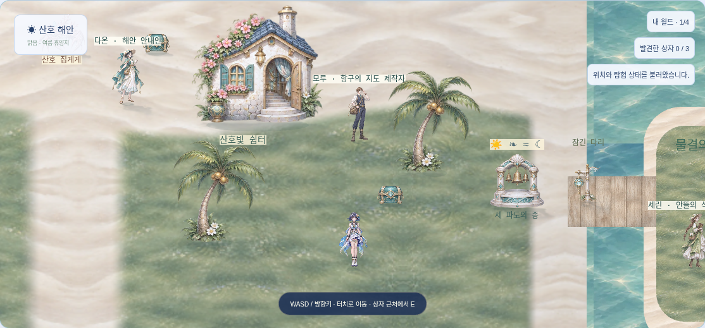
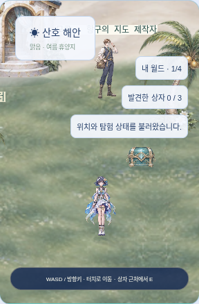
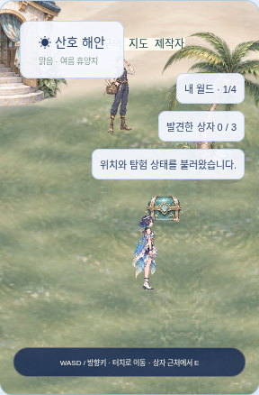

# 해린 고유 탐험 아바타 시범

2026-11-04 · 계획 A2의 첫 캐릭터만 적용했다. 나머지 7명의 고유 탐험 아바타는 대기 중이다.

캐릭터 메뉴의 **탐험 모습 → 해린 → 탐험 모습 저장**으로 선택한다. 보유하고 4인 편성에 넣은 해린만 사용할 수 있다. 편성 안의 자리 교환은 모습을 유지하며, 대기 캐릭터로 교체해 해린을 편성에서 빼면 공통 여행자로 돌아간다. 능력치나 전투 출전 캐릭터를 변경하는 기능은 아니다.

## 제작과 마감

- 기존 `source/heroes.png`의 해린을 참고해 이미지 생성 도구로 남/서/동/북 각 정지 1·보행 2, 총 12포즈를 새로 제작했다. 세 번째 생성에서 옆모습의 팔 반대 자세를 보완했다. 남색 단발·꽃 장식·백색/청색/금색 의상과 성인 비례를 유지했다. 기존 초상화나 공통 여행자 원본은 수정하지 않았다.
- 채택한 1024×1536 PNG를 [원본](source/haerin-avatar.png)으로 그대로 보존한다. `scripts/export-avatar.py`는 WebP 코덱 내보내기와 atlas 메타데이터만 만든다. 회화 수정·프레임 픽셀 재배치는 하지 않는다.
- 원본에 낮은 알파의 옅은 매트가 남아 있어 작은 월드 스프라이트의 WebP는 `quality=70, alpha_quality=0`으로 내보냈다. 알파는 0/254 두 단계다. 희미한 매트를 제거하는 대신 원본 가장자리의 알파 계조는 보존하지 못한다. 런타임 축소/보간을 사용하며 원본 알파는 PNG에 남겼다.
- atlas는 투명 여백을 제외한 실제 영역과 가상 셀 342×384를 기록한다. 발 기준선은 모든 포즈에서 376이다. 메타데이터의 세로 오프셋으로 맞추고 가로 위치는 원본대로 유지한다. 표시 높이 92에 균일 배율을 적용해 가로세로 비율을 유지한다.
- 각 프레임의 프로시저럴 노멀·실루엣 그림자·수광 가림은 실제 해린 프레임을 사용한다. 수작업 재질 노멀이나 3D 모델은 아니다. 기본 고품질 24프레임에 해린 12프레임을 더해 최대 36프레임/3 atlas를 캐시한다. 해린 노멀 원시 비트맵만 약 6MiB가 추가되며 GPU/총 메모리 실측값은 아니다.

## 저장과 동기화

서버가 인증된 계정의 보유/편성과 허용 ID를 검증한다. 별도 `avatarRevision`으로 다른 창의 덮어쓰기를 차단하며 그래픽 설정의 버전과 독립적이다. 새 마이그레이션은 기존 UserSettings에 선택과 버전 두 열만 추가한다. 저장/재접속/방문/소유자 퇴장 복귀에서 자기 모습을 유지하고, 같은 월드 참가자에게 서버가 검증한 모습을 전송한다.

해린 WebP 112,556바이트는 선택하거나 해린 방문자를 만날 때 한 번 지연 로드한다. 공통 여행자만 쓰는 초기 화면에서는 요청하지 않는다. 로딩 실패 시 공통 여행자를 표시하고 안내한다. 다시 선택하거나 새로고침하여 재시도할 수 있다. 전체 WebP 7종 합계 2,091,152바이트로 2MiB 예산보다 6,000바이트 적다. 향후 7인 확대 전에 자산 예산을 다시 설계해야 한다.

## 검증 및 적용 화면

서버 151개(skip 0)와 TypeScript/Vite 빌드를 통과했다. DB/API 3개는 인증·보유/편성·지원 ID·다른 계정 지정 차단, 선택/그래픽 버전 분리·충돌, 편성 내 교환/제외 및 요청 중복을 검사한다. 아트 검사 2개는 12프레임·고정 발 기준선·범위·실효 선택을 검증한다. 실기기 FPS·메모리·발열, 다른 브라우저와 나머지 7인 검수는 완료되지 않았다.

PC·모바일의 관련 16개 항목을 검사했다. 첫 실행은 15통과/PC 방문 보행 1실패였다. 900ms 관찰 창에서 정지 자세만 잡혀 3초로 늘렸으며 실제 보행 프레임 단언은 유지했다. 아바타/방문 4개를 재검사해 모두 통과했으며, 관련 16개 항목의 통과를 확인했다. 4인 협동·월드 복귀·원격 모습·노멀/그림자·수광 가림·설정·일반 기술 학습의 기존 검증을 보존했다. 전체 브라우저 목록 52개 재실행은 아니다.

| PC | 모바일 | 모바일 저품질 |
|---|---|---|
|  |  |  |
